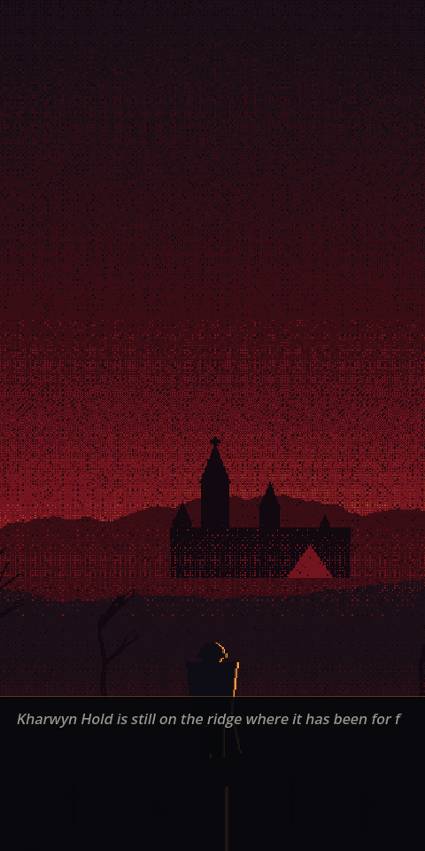
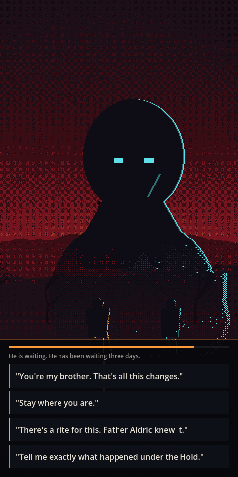
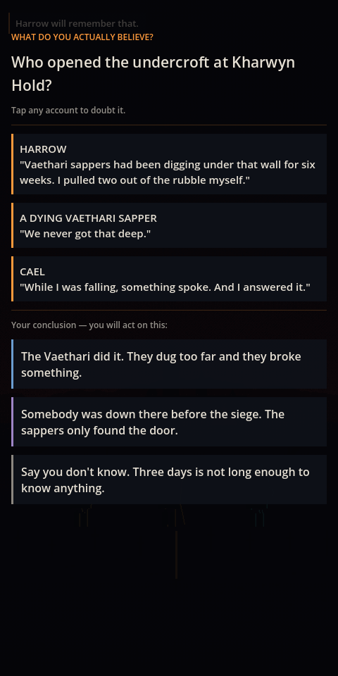
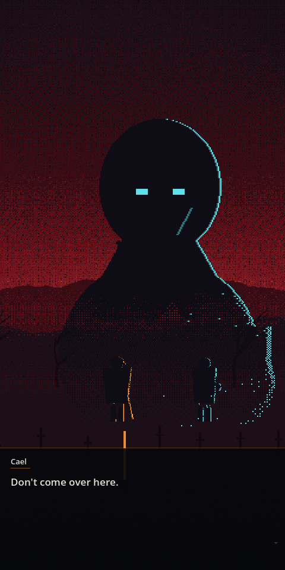
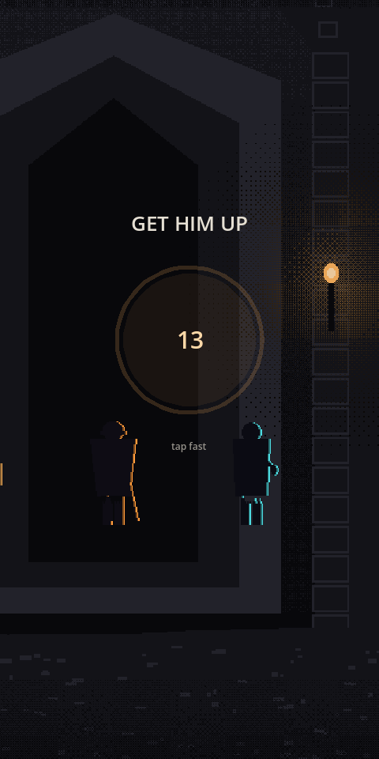
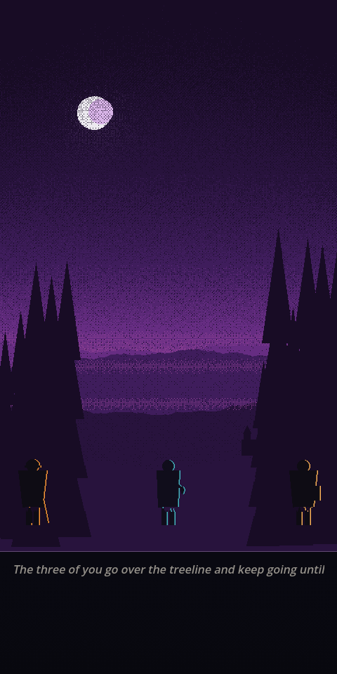
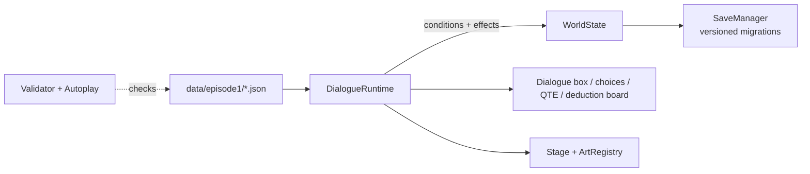

# The Devouring

A dark-fantasy, Telltale-style narrative adventure for iPhone, built in Godot 4: branching dialogue, timed choices, touch QTEs and a deduction board, told in portrait pixel art.

<p align="center">
  
  
  
</p>
<p align="center">
  
  
  
</p>

> Aldreth calls it the Devouring.
> The Prophet calls it the Awakening.
> Nobody knows which is true.

## What it is

The story is set at the moment magic is discovered and immediately becomes a weapon two empires are already fighting over. You play a displaced Aldrethi soldier whose 19-year-old brother came out of the Rupture with light in his hands. Every frame above was captured from the running game.

## Features

- **Story as data.** Scenes are JSON node graphs (`data/episode1/*.json`); adding content needs no GDScript.
- **"X will remember that."** World state, flags, relationship stats and rumors persist across scenes and episodes, with versioned save migration.
- **Timed and untimed choices** with gated options; silence on a timed choice is always an authored outcome.
- **Touch QTEs:** tap, rapid tap, hold and swipe.
- **Dialogue deduction board** where no answer is marked correct; the story judges your beliefs later.
- **Parallax stage** with two camera registers and a single art registry so commissioned art can drop in later.
- **Offline tooling:** a static graph validator, a 400-run randomized autoplay for coverage, and a beat-by-beat screenshot capture tool.
- Procedurally generated placeholder art and audio (`tools/gen_art.py`), so the repo carries no licensed assets.

## How it works



Conditions are real GDScript expressions evaluated against `WorldState`. See [`docs/ARCHITECTURE.md`](docs/ARCHITECTURE.md).

## Tech stack

Godot 4.7 · GDScript · `gl_compatibility` renderer · iOS export (arm64, iOS 15+) · Python 3 + Pillow for asset generation.

## Project structure

```
data/episode1/   scene graphs (JSON)
src/autoload/    WorldState, SaveManager, SceneDirector, AudioDirector
src/dialogue/    runtime, condition evaluator, effects
src/stage/       parallax stage and ArtRegistry
src/ui/          dialogue box, choice panel, QTE widget, deduction board
src/tools/       Validator, Autoplay, Capture scenes
assets/          generated backdrops, characters, audio, icon
tools/           gen_art.py, gen_icon.py, build_ios.sh
docs/            art direction, dialogue format, architecture, iOS build notes, screens
ios/             ExportOptions plists (team ID left empty)
```

## Status

**Playable vertical slice.** Every core system is built and Episode 1 Scene 1, *The Tremor*, plays
end to end.

| | |
| :-- | :-- |
| World state / flags / relationships | done |
| Save/load with multi-episode migration | done |
| JSON dialogue graph format + runtime | done |
| "X will remember that" | done |
| Timed & untimed choices, gated options | done |
| Touch QTEs (tap / rapid / hold / swipe) | done |
| Dialogue-deduction puzzle board | done |
| Parallax stage + two camera registers | done |
| Placeholder art & audio (in-palette, zero licensing risk) | done |
| Episode 1 Scene 1 — 108 nodes, 11 branching options | done |
| iOS app builds & archives (arm64, validates for store) | done |
| App icon + launch storyboard + safe-area insets | done |
| Episode 1 Scenes 2+ | todo |
| Licensed pixel font | todo |
| Real sound design | todo |
| Code signing / TestFlight | not yet (needs a signing team) |


---

## Run it

```bash
GODOT=/Applications/Godot.app/Contents/MacOS/Godot   # path to your Godot 4.7 binary

$GODOT --path .                                     # play
```

## Verify it

Run all three before committing content changes:

```bash
# 1. Static graph check — missing targets, orphaned nodes, bad conditions, unauthored silence
$GODOT --headless --path . res://src/tools/Validator.tscn

# 2. 400 randomised playthroughs — coverage + runtime errors
$GODOT --headless --path . res://src/tools/Autoplay.tscn

# 3. Screenshot named story beats (needs a display; writes to user://captures)
$GODOT --path . res://src/tools/Capture.tscn
```

Current output:

```
Checked 1 scene file(s), 108 node(s).
All graphs valid.

Node coverage:   108 / 108 (100.0%)
Option coverage: 11 / 11
QTE outcomes:    213 success / 187 fail
Choice timeouts: 148
All runs completed without error.
```

## Regenerate art

```bash
python3 tools/gen_art.py               # backdrops, character silhouettes, audio
python3 tools/gen_icon.py              # app icon set + boot splash
$GODOT --headless --path . --import    # REQUIRED, or Godot serves the stale import cache
```

## Open and build in Xcode

Godot generates the Xcode project; it is not checked in.

1. Install Godot 4.7 and its iOS export templates (Godot → Editor → Manage Export Templates).
2. Export the Xcode project:
   ```bash
   GODOT=/Applications/Godot.app/Contents/MacOS/Godot tools/build_ios.sh export
   ```
3. Open `../TheDevouring-build/ios/TheDevouring.xcodeproj` in Xcode.
4. Under Signing & Capabilities pick your own team (the repo ships with an empty team ID), select a
   physical iPhone, and press Run. The iOS Simulator on Apple Silicon cannot run Godot's iOS export;
   see [`docs/IOS_BUILD.md`](docs/IOS_BUILD.md).

## Build the iOS app from the command line

```bash
TEAM_ID=<your team> tools/build_ios.sh archive   # Xcode project + unsigned arm64 archive
tools/build_ios.sh ipa                 # signed .ipa   (needs an Apple ID in Xcode)
tools/build_ios.sh upload              # → TestFlight
```

Output goes to `../TheDevouring-build/ios/`. Currently `archive` succeeds and validates for the
store; signing needs a one-time `Xcode → Settings → Accounts` sign-in.

**Read [`docs/IOS_BUILD.md`](docs/IOS_BUILD.md) before touching the iOS config.** It documents seven
non-obvious traps, including an export that fails with a completely blank error message and why the
iOS Simulator cannot run this on an Apple Silicon Mac.

---

## Write an episode

Story is data. Adding content means writing JSON — no GDScript.

```
data/episode1/<scene_id>.json     ← the scene graph
SceneDirector.EPISODES            ← add the scene id to the manifest
```

Read [`docs/DIALOGUE_FORMAT.md`](docs/DIALOGUE_FORMAT.md) for the schema. A taste:

```json
{ "type": "choice",
  "prompt": "He is waiting. He has been waiting three days.",
  "timer": 8.0, "on_timeout": "react_silence",
  "options": [
    { "id": "reassure", "text": "\"You're my brother. That's all this changes.\"",
      "tone": "warm", "remember": "brother",
      "effects": [ { "adjust": "brother", "stat": "trust", "by": 3 } ],
      "next": "react_reassure" },
    { "id": "step_aside", "text": "Step to your left.",
      "if": "not has_flag('chose_cael_first')",
      "locked_text": "Step to your left. [You already told him he was your brother]",
      "next": "harrow_aside" }
  ]
}
```

Conditions are real GDScript expressions evaluated against `WorldState`, so `trust('brother') >= 3`
and `believes('vaethari_broke_the_seal')` work and are checked offline by the validator.

## Docs

| File | What it's for |
| :--- | :------------ |
| [`CLAUDE.md`](CLAUDE.md) | Project rules, hard constraints, writing register, validation commands (also used by AI coding agents) |
| [`docs/ART_DIRECTION.md`](docs/ART_DIRECTION.md) | **Locked.** Palettes, dithering, lighting, composition — derived from the reference board |
| [`docs/DIALOGUE_FORMAT.md`](docs/DIALOGUE_FORMAT.md) | Full content schema |
| [`docs/ARCHITECTURE.md`](docs/ARCHITECTURE.md) | System layout, the three seams, save compatibility, known gaps |
| [`docs/GAME_BRIEF.md`](docs/GAME_BRIEF.md) | Original design brief |

## Design commitments worth not relitigating

- **Portrait, not landscape.** Every piece on the reference board is vertical, and it's a
  one-handed phone game with a lot of reading.
- **No option is marked correct in a deduction.** The world premise is that nobody can verify
  anything. The board records what the player chose to believe; the story vindicates or humiliates
  them episodes later.
- **Silence is an authored choice.** Every timed choice must declare `default` or `on_timeout`. The
  validator fails the build otherwise.
- **The protagonist has no personality.** He asks and reacts. His characterisation is whatever the
  player picked.
- **Failing a QTE in Episode 1 costs state, never a life.** Death-on-fail belongs to a later episode
  where the player understands the verbs.
- **All art flows through `ArtRegistry`.** Commissioned art drops in via a registry edit.

---

Built by [Ian Royes](https://github.com/ianroyes-sys)
